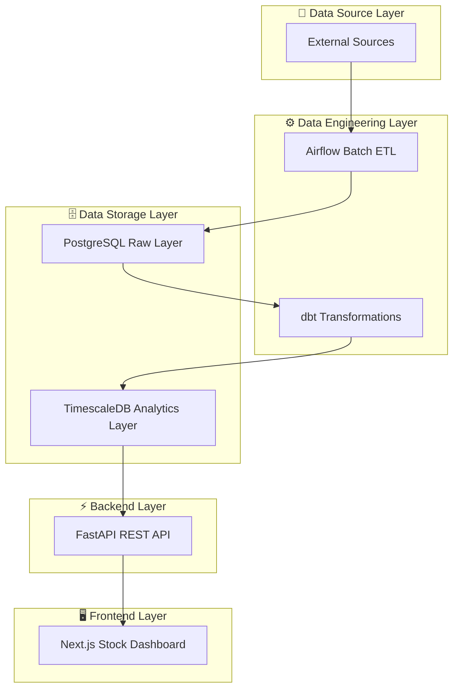

# Foundation Flow - Financial Analytics Platform

A production-grade, on-premises financial analytics platform for individual stock analysis. 

## Overview

Foundation Flow is a **batch-only**, **on-prem** analytics system that ingests stock data from Yahoo Finance, transforms it using industry-standard data tools, and serves insights through a modern web interface.

### Key Features

- **Stock-Specific Dashboards**
- **Historical OHLC Analysis**
- **Full Local Development**
- **Fundamental Metrics**
- **Technical Indicators**
- **Clean Architecture**

## System Architecture


---

# Data Source

## External Sources (Single Source of Truth, for the moment)

All data comes exclusively from Yahoo Finance:

### Market Data
- OHLC historical prices
- Volume data
- Adjusted close prices

### Fundamental Data
- Market cap
- P/E ratio
- EPS
- Dividend yield
- Balance sheet snapshots

### Company Metadata
- Sector
- Industry
- Exchange
- Market state

---

# Frontend Layer

- Individual stock analysis
- Price charts
- Metrics dashboards
- Historical performance

---

# Final Technology Stack

## Data Engineering

- Yahoo Finance API (single source)
- Apache Airflow (ETL orchestration)
- PostgreSQL (raw storage)
- TimescaleDB (time-series analytics)
- dbt (transformations)

## Backend

- FastAPI (REST API)

## Frontend

- Next.js
- TypeScript
- Tailwind CSS

## Visualization

- TradingView Lightweight Charts
- Apache ECharts

## Infrastructure

- Docker

---

## Complete Directory Structure

```
foundation-flow/
├── backend/                            # FastAPI REST API
│   ├── app/
│   │   ├── main.py                     ## FastAPI app entry point
│   │   └── __init__.py
│   ├── api/
│   │   ├── stocks.py                   ## Stock endpoints (7 routes)
│   │   └── __init__.py
│   ├── services/
│   │   ├── stock_service.py            ## Business logic (async queries)
│   │   └── __init__.py
│   ├── db/
│   │   ├── connection.py               ## Connection pooling (asyncpg)
│   │   └── __init__.py
│   ├── models/
│   │   ├── schemas.py                  ## Pydantic models (6 schemas)
│   │   └── __init__.py
│   ├── tests/
│   │   └── __init__.py
│   ├── requirements.txt                ## Python dependencies
│   └── README.md                       ## Backend documentation
│
├── frontend/                           # Next.js 14 Dashboard
│   ├── app/
│   │   ├── layout.tsx                  ## Root layout with header/footer
│   │   ├── page.tsx                    ## Home page (stock search)
│   │   ├── stock/[ticker]/
│   │   │   └── page.tsx                ## Stock detail page
│   │   ├── globals.css                 ## Global styles (Tailwind)
│   │   └── __init__.py
│   ├── components/
│   │   ├── PriceChart.tsx              ## Lightweight Charts candlesticks
│   │   ├── MetricsPanel.tsx            ## Metrics display
│   │   └── __init__.py
│   ├── lib/
│   │   ├── api.ts                      ## Axios API client
│   │   └── __init__.py
│   ├── hooks/                          ## Future React hooks
│   ├── styles/                         ## Additional stylesheets
│   ├── package.json                    ## Node dependencies
│   ├── next.config.js                  ## Next.js configuration
│   ├── tailwind.config.js              ## Tailwind configuration
│   └── README.md                       ## Frontend documentation
│
├── airflow/                            # Data Orchestration
│   ├── dags/
│   │   ├── yahoo_fetch_daily_prices.py ## Daily prices DAG
│   │   ├── yahoo_fetch_fundamentals.py ## Weekly fundamentals DAG
│   │   └── __init__.py
│   ├── plugins/
│   │   └── __init__.py
│   ├── operators/
│   │   ├── yahoo_finance_operators.py  ## 3 custom operators
│   │   │   ├── YahooFinanceBaseOperator
│   │   │   ├── FetchYahooFinancePricesOperator
│   │   │   ├── FetchYahooFinanceFundamentalsOperator
│   │   └── __init__.py
│   ├── __init__.py
│   └── README.md                       ## Airflow documentation
│
├── dbt/                                # Data Transformation
│   ├── models/
│   │   ├── staging/
│   │   │   ├── stg_prices.sql          ## Clean price data
│   │   │   └── stg_fundamentals.sql    ## Clean fundamentals
│   │   ├── intermediate/
│   │   │   ├── int_returns.sql         ## Calculate returns
│   │   │   └── int_volatility.sql      ## Calculate volatility
│   │   ├── marts/
│   │   │   ├── fact_stock_prices.sql   ## Historical fact table
│   │   │   └── fact_stock_metrics.sql  ## Latest metrics snapshot
│   │   ├── schema.yml                  ## Data documentation & tests
│   │   └── __init__.py
│   ├── tests/                          ## dbt tests directory
│   ├── macros/                         ## dbt macros (future)
│   ├── dbt_project.yml                 ## dbt configuration
│   ├── __init__.py
│   └── README.md                       ## dbt documentation
│
├── infrastructure/                     # Docker & Deployment
│   ├── docker/
│   │   ├── Dockerfile.airflow          ## Airflow image (Airflow 2.7.3)
│   │   ├── Dockerfile.backend          ## FastAPI image (Python 3.11)
│   │   └── Dockerfile.frontend         ## Next.js image (Node 18)
│   ├── scripts/
│   │   ├── init_postgres.sql           ## PostgreSQL schema init
│   │   └── init_timescale.sql          ## TimescaleDB schema init
│   ├── docker-compose.yml              ## Full stack orchestration
│   ├── env.example                     ## Environment template
│   └── README.md                       ## Infrastructure documentation
│
├── docs/                               # Architecture & Guides
│   ├── architecture.md                 ## System design (6 layers)
│   ├── data_flow.md                    ## Data pipeline flow
│   ├── schema_design.md                ## Database schema details
│   └── onboarding.md                   ## Getting started guide
│
└── README.md                           # Project overview
```

## Core Components Created

### 1. Backend (FastAPI) ✅
- **Main App**: `app/main.py` with lifespan management
- **API Routes**: 7 endpoints for stock data
- **Services**: Async database queries with retry logic
- **Database**: Connection pooling for PostgreSQL + TimescaleDB
- **Models**: 6 Pydantic schemas for validation
- **OpenAPI**: Auto-generated API documentation at `/docs`

### 2. Frontend (Next.js) ✅
- **Home Page**: Stock search and discovery
- **Stock Detail**: Interactive charts and metrics
- **Components**: PriceChart (TradingView), MetricsPanel
- **API Client**: Axios with error handling
- **Styling**: Tailwind CSS dark theme
- **Responsive**: Mobile and desktop layouts

### 3. Airflow DAGs ✅
- **Daily Prices**: OHLCV data from Yahoo Finance (6 PM ET)
- **Weekly Fundamentals**: P/E, dividend, market cap (Monday 3 AM ET)
- **Custom Operators**: Fetch, validate, store data
- **Error Handling**: Retry logic with exponential backoff
- **Logging**: Comprehensive pipeline monitoring

### 4. dbt Models ✅
- **Staging**: 2 views for data cleaning
- **Intermediate**: 2 tables for calculations (returns, volatility)
- **Marts**: 2 fact tables for analytics
- **Tests**: Data quality assertions
- **Documentation**: Auto-generated lineage

### 5. Database Schemas ✅
- **PostgreSQL Raw**: Yahoo prices, fundamentals, metadata
- **TimescaleDB Analytics**: 
  - Hypertables for OHLCV, returns, volatility
  - Compression for data > 30 days
  - Continuous aggregates for pre-computed views
  - Dimension tables for metadata

### 6. Docker Infrastructure ✅
- **Airflow**: Scheduler + Webserver with LocalExecutor
- **PostgreSQL**: Raw data layer on port 5432
- **TimescaleDB**: Analytics layer on port 5433
- **FastAPI**: Backend API on port 8000
- **Next.js**: Frontend on port 3000
- **Volumes**: Persistent data storage
- **Health Checks**: All services monitored

### 7. Documentation ✅
- **Architecture**: 3-layer data flow, design decisions
- **Data Flow**: Pipeline diagram with error handling
- **Schema Design**: Complete database documentation
- **Onboarding**: Step-by-step setup and troubleshooting
- **READMEs**: Module-specific documentation (6 files)

## Key Features

### Data Ingestion
- ✅ Yahoo Finance API integration
- ✅ Daily OHLCV prices
- ✅ Weekly fundamentals
- ✅ Idempotent, retryable operations
- ✅ Raw data versioning

### Transformations
- ✅ Data cleaning and validation
- ✅ Returns calculation (daily, weekly, monthly, annual)
- ✅ Volatility calculation (20d, 60d, 252d rolling)
- ✅ Moving averages (20, 50, 200 day)
- ✅ dbt tests and documentation

### Analytics
- ✅ TimescaleDB hypertables
- ✅ Automatic data compression
- ✅ Continuous aggregates
- ✅ Strategic indexing
- ✅ Time-series optimization

### API
- ✅ RESTful endpoints
- ✅ Async database queries
- ✅ Connection pooling
- ✅ Comprehensive error handling
- ✅ OpenAPI documentation

### Frontend
- ✅ Stock search and discovery
- ✅ Interactive candlestick charts
- ✅ Technical indicators display
- ✅ Fundamental metrics panel
- ✅ Responsive design

## Quick Start

```bash
# 1. Start all services
docker compose -f infrastructure/docker-compose.yml up -d

# 2. Wait 2-3 minutes for initialization

# 3. Access services
# Airflow: http://localhost:8080
# FastAPI: http://localhost:8000/docs
# Frontend: http://localhost:3000

# 4. Trigger data ingestion via Airflow UI or API
curl -X POST http://localhost:8080/api/experimental/dags/yahoo_fetch_daily_prices/dag_runs

# 5. Wait for pipeline to complete (~5-10 minutes)

# 6. View data in frontend at http://localhost:3000
```

## Technology Stack

| Component        | Technology     | Version |
|------------------|----------------|---------|
| Orchestration    | Apache Airflow | 2.7.3   |
| Transformation   | dbt            | Latest  |
| Raw Data         | PostgreSQL     | 15      |
| Analytics        | TimescaleDB    | Latest  |
| Backend API      | FastAPI        | 0.104.1 |
| Frontend         | Next.js        | 14.0.0  |
| Containerization | Docker         | 20.10+  |

## Understand Project Better

1. **Explore**: Read [Onboarding Guide](docs/onboarding.md)
2. **Deploy**: Follow [Infrastructure README](infrastructure/README.md)

### ⚠️ TO BE DEVELOPED

- Add authentication/authorization (JWT)
- Enable SSL/TLS
- Set up monitoring and alerting
- Configure backups
- Use Kubernetes for orchestration
- Add rate limiting
- Implement caching (Redis)
- Set up CI/CD pipelines